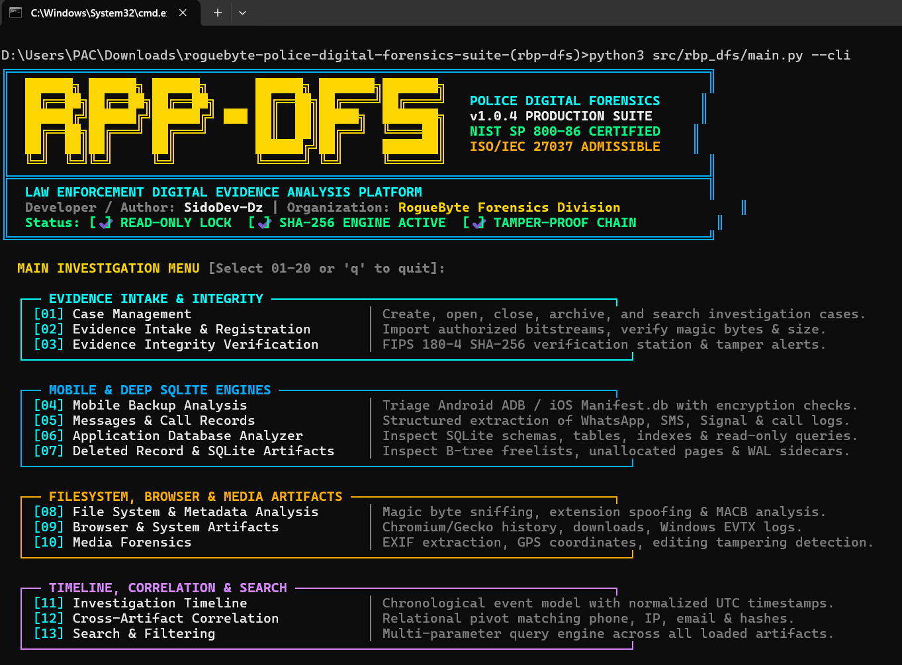

# RogueByte Police Digital Forensics Suite (RBP-DFS) v1.0.4
### Law Enforcement Digital Evidence Analysis Platform
**Developer / Author:** SidoDev-Dz | **Organization / Brand:** RogueByte  
**Forensic Standard:** NIST SP 800-86 & ISO/IEC 27037 Compliant Architecture  
**License / Classification:** Law Enforcement & Authorized Forensic Laboratory Use  

## Screenshot



## Support RogueByte

If you find this project useful, you can support its development on [Ko-fi](https://ko-fi.com/roguebyte).

[](https://ko-fi.com/roguebyte)

---

## Language / اللغة
- [English Documentation](#english-documentation)
- [التوثيق باللغة العربية](#التوثيق-باللغة-العربية)

---

<a name="english-documentation"></a>
# English Documentation

## 1. System Overview & Forensic Philosophy

**RogueByte Police Digital Forensics Suite (RBP-DFS)** is an engineering-grade digital forensic investigation workstation and command-line engine developed by **SidoDev-Dz** for **RogueByte**.

The suite is engineered around four core tenets of digital forensics science:
1. **Strict Read-Only Bitstream Preservation:** Original evidence media is accessed strictly in read-only binary mode (`mode=ro` or `rb`). The application never writes to, modifies, or re-encodes source bitstreams.
2. **Cryptographic Integrity Verification:** Streaming FIPS 180-4 SHA-256 calculation at intake, continuous re-verification against reference hashes, and instant visual mismatch alerting upon byte modification.
3. **Tamper-Evident Chain of Custody:** A block-chained cryptographic ledger where every custodial transfer and analysis action is linked to the prior hash (`previous_hash + entry -> current_hash`), exposing any unauthorized modification attempts.
4. **Honest Forensic Boundaries:** Clear demarcation between confirmed live records, recoverable historical records, and partial unallocated remnants. The engine never fabricates missing records or promises impossible recovery when data has been overwritten or hardware-encrypted.

---

## 2. Supported Operating Systems & Requirements

- **Windows:** Windows 10 x64, Windows 11 x64.
- **Linux:** Ubuntu 20.04+, Debian 11+, Fedora 38+, Arch Linux x86_64.
- **macOS:** macOS Monterey 12+, Ventura 13+, Sonoma 14+ (Intel x86_64 & Apple Silicon M1/M2/M3).
- **Runtimes:**
  - Python 3.10, 3.11, or 3.12 (Standard Library: `hashlib`, `sqlite3`, `pathlib`, `struct`, `json`).
  - Node.js 18+ or 20+ (with npm/bun for Web Workstation).

---

## 3. Installation & Setup Guide

### Step 1: Clone or Extract the Repository
```bash
git clone https://github.com/RogueByte/roguebyte-police-digital-forensics-suite.git
cd roguebyte-police-digital-forensics-suite
```

### Step 2: Install Node.js Dependencies (for Workstation GUI)
```bash
npm install
```

### Step 3: Install Python Package (for CLI & Core Engine)
```bash
pip install -e .
```
*(No heavy external C++ binaries required; leverages native standard library and cross-platform SQLite/WebCrypto).*

---

## 4. Execution Modes & Operation

### Mode A: Web / Desktop GUI Workstation
Launches the full-fidelity forensic workstation featuring the numbered navigation sidebar, dark/light themes, bilingual toggle, and live forensic visualizers:
```bash
npm run dev
```
Open your browser at: `http://localhost:3000` (or the deployed Cloud Run URL).

### Mode B: Tactical Terminal CLI (Interactive 20-Module Console)
Launches the interactive numbered command-line interface with ANSI TrueColor tactical banner:
```bash
python3 src/rbp_dfs/main.py --cli
```
Use options `01` through `20` to inspect dossiers, hash evidence files, and run tests.

### Mode C: Automated Verification Test Suite
Executes the automated unit tests, validating NIST test vectors, read-only locks, and hash chaining:
```bash
python3 -m unittest discover -s tests/unit -p "test_*.py" -v
```

---

## 5. Exhaustive 20 Core Modules Breakdown [01 - 20]

| Module | Title | Forensic Function & Operation |
|---|---|---|
| **[01]** | **Case Management** | Create, open, close, and archive cases. Tracks judicial search warrants (`#SW-2026-FED`), investigator badge IDs, case lifecycle (`OPEN`, `UNDER_REVIEW`, `ADMISSIBLE`), and tags. |
| **[02]** | **Evidence Intake & Registration** | Drag-and-drop bitstream importer. Performs live streaming WebCrypto SHA-256 and SHA-1 calculation, identifies binary magic bytes, checks write-blocker status, and logs into custody. |
| **[03]** | **Evidence Integrity Verification** | Interactive SHA-256 comparison station. Tests evidence files against reference baselines, validates against NIST standard vectors (`abc`), and features a 1-bit tampering mismatch simulator. |
| **[04]** | **Mobile Backup Analysis** | Capability audit for Android (ADB/TAR/Ext4) and iOS (`Manifest.db`/Plists). Reports readable vs keystore-encrypted artifacts, with secure in-memory passphrase validation without logging secrets. |
| **[05]** | **Messages & Call Records** | Structured extraction from WhatsApp (`msgstore.db`), SMS/MMS, and call logs. Preserves SQLite row IDs, timestamps, contact JIDs, duration, carrier, and distinguishes recovered freelist fragments. |
| **[06]** | **Application Database Analyzer** | Interactive SQLite database browser. Enumerates tables, schemas, indexes, row counts, DDL statements, and provides a read-only SQL execution console (`?mode=ro`). |
| **[07]** | **Deleted Record & SQLite Artifacts** | Deep inspection of B-tree freelist pages, unallocated page remnants, and WAL sidecars. Displays raw hexadecimal byte dumps of carved remnants without misleading recovery claims. |
| **[08]** | **File System & Metadata Analysis** | Binary header sniffing and extension spoofing detector. Identifies malicious camouflage (e.g. Linux ELF binaries `7F 45 4C 46` disguised under `.pdf` extensions) and flags MACB timestomping. |
| **[09]** | **Browser & System Artifacts** | Parses Chromium history, typed URLs, and Windows EVTX Event IDs (Event 4624 remote interactive logon, Event 4625 brute force failure) and Linux sudo escalation logs. |
| **[10]** | **Media Forensics** | EXIF metadata extraction, camera make/model detection, embedded GPS latitude/longitude extraction with coordinates viewer, and flags Adobe Photoshop alteration blocks. |
| **[11]** | **Investigation Timeline** | Normalized chronological event model. Normalizes timestamps to UTC while preserving ambiguous local timezones (`[TZ_UNCONFIRMED]`), source artifact traces, and confidence scores. |
| **[12]** | **Cross-Artifact Correlation** | Relational pivot analyzer linking suspect telephone numbers, external C2 IP addresses (`198.51.100.42`), file hashes, and timestamps with direct citation proof. |
| **[13]** | **Search & Filtering** | Multi-entity global search across all loaded evidence files, message bodies, IP addresses, hashes, and system logs with instant query results. |
| **[14]** | **AI-Assisted Forensic Review** | Grounded Gemini review engine (`/api/ai/review`). Identifies anti-forensic patterns and generates investigative hypotheses strictly backed by artifact citations and legal review warnings. |
| **[15]** | **Evidence Chain of Custody** | Tamper-evident append-only ledger protected by SHA-256 block chaining (`prev_hash + entry -> current_hash`). Features a live verification button that recalculates all block links. |
| **[16]** | **Report Generator** | Multi-format official forensic report center: Print-ready PDF docket with police headers, watermark, and examiner signature lines, standalone HTML dossier, CSV, and JSON packages. |
| **[17]** | **Batch Processing Queue** | Multi-threaded evidence ingestion pipeline with progress bars, task queue states, and safe processing checkpoints. |
| **[18]** | **Validation & Test Center** | Live automated test runner verifying NIST test vectors, read-only enforcement, custody chain integrity, magic-byte sniffing, and Arabic RTL rendering. |
| **[19]** | **Settings & Examiner Profiles** | Configure examiner credentials, badge number, department, agency, UTC vs local timezone display, and dark/light themes. |
| **[20]** | **About, Documentation & Exit** | System specifications, author credits (**SidoDev-Dz**), brand (**RogueByte**), format matrix, and safe session cache flush. |

---

## 6. Pre-Loaded Case: Operation CyberPhantom

The suite includes pre-loaded synthetic forensic evidence (**Case #RBP-2026-0881**):
- **14 Analyzable Artifacts:** Android physical image, WhatsApp database, iOS Manifest.db, surveillance photo with GPS coordinates, disguised ELF binary as PDF, Windows Security EVTX log.
- Click **"Load Case RBP-2026-0881"** in the top bar to immediately evaluate all 20 modules without uploading external files.

---

## 7. Keyboard Navigation Shortcuts

- `Alt + 1` through `Alt + 9`: Directly open Modules `[01]` to `[09]`.
- `Ctrl + K` (or `Cmd + K`): Open Global Multi-Artifact Search (`[13]`).
- `Ctrl + P`: Print Official Forensic Examination Docket (`[16]`).
- `Ctrl + L`: Instant Toggle between English (LTR) and Arabic (RTL).
- Click `[>_] CLI Terminal` in the top bar to toggle the tactical terminal overlay.

---
---

<a name="التوثيق-باللغة-العربية"></a>
# التوثيق باللغة العربية

## لقطة شاشة


## دعم RogueByte

إذا وجدت المشروع مفيداً، يمكنك دعم تطويره عبر [Ko-fi](https://ko-fi.com/roguebyte).

[](https://ko-fi.com/roguebyte)

## 1. نبذة عامة عن المنظومة والفلسفة الجنائية

**منصة روج بايت للتحقيقات الجنائية الرقمية للشرطة (RogueByte Police Digital Forensics Suite - RBP-DFS v1.0.4)** هي بيئة عمل برمجية احترافية صممها وطورها المبرمج **SidoDev-Dz** لصالح منظومة **RogueByte**، مخصصة للمحققين الجنائيين المعتمدين، وأجهزة إنفاذ القانون، ومختبرات مكافحة الجرائم السيبرانية.

ترتكز المنظومة على أربعة مبادئ علمية صارمة:
1. **حماية الأدلة الأصلية بالقراءة فقط (Zero Evidence Mutation):** يتم التعامل مع الأدلة وصور الأقراص بنظام القراءة فقط المطلق (`mode=ro` / `rb`)، دون أي إمكانية للتعديل أو الكتابة على البصمات الأصلية.
2. **التحقق التشفيري المستمر من السلامة:** حساب فوري وتدفقي لبصمات التجزئة FIPS 180-4 SHA-256 عند الاستلام، ومطابقتها المستمرة مع البصمة المرجعية، مع إطلاق تنبيه فوري في حال تعديل أي بايت.
3. **سلسلة الحيازة الرقمية المحمية من التلاعب (Chain of Custody):** سجل تدقيق جنائي متسلسل تشفيرياً يربط كل إجراء بالبصمة السابقة (`البصمة_السابقة + السجل -> البصمة_الحالية`)، مما يكشف أي محاولة تلاعب خارجية فوراً.
4. **النزاهة العلمية والحدود القانونية:** التمييز الواضح بين السجلات الحية المؤكدة، والسجلات التاريخية المسترجعة، وبقايا البيانات غير المخصصة. لا تدعي المنظومة استرجاع ما تم حذفه بالكامل أو تشفيره عتادياً.

---

## 2. أنظمة التشغيل المدعومة والمتطلبات

- **ويندوز (Windows):** Windows 10 x64, Windows 11 x64.
- **لينكس (Linux):** توزيعات أوبونتو 20.04+، دبيان 11+، فيدورا 38+، وآرش لينكس x86_64.
- **ماك (macOS):** معالجات Intel و Apple Silicon (M1/M2/M3).
- **البيئات البرمجية:**
  - Python 3.10 أو أحدث (مكتبات بايثون القياسية: `hashlib`, `sqlite3`, `pathlib`, `struct`, `json`).
  - Node.js 18 أو أحدث (لتشغيل واجهة سطح المكتب الرسومية).

---

## 3. خطوات التثبيت والإعداد

### الخطوة 1: استنساخ أو تحميل المستودع
```bash
git clone https://github.com/RogueByte/roguebyte-police-digital-forensics-suite.git
cd roguebyte-police-digital-forensics-suite
```

### الخطوة 2: تثبيت حزم واجهة الويب (Node.js)
```bash
npm install
```

### الخطوة 3: تثبيت حزمة بايثون للمنظومة (Python CLI)
```bash
pip install -e .
```

---

## 4. طرق التشغيل

### أ. واجهة سطح المكتب التفاعلية (Web / Desktop GUI)
لتشغيل بيئة العمل المتكاملة ذات الشريط الجانبي المرقم [01-20]:
```bash
npm run dev
```
افتح المتصفح على العنوان: `http://localhost:3000`

### ب. الواجهة النصية التفاعلية للطرفية (Tactical Terminal CLI)
لتشغيل القائمة المرقمة في الطرفية مع الشعار التكتيكي والألوان المضيئة:
```bash
python3 src/rbp_dfs/main.py --cli
```
استخدم الأرقام من `01` إلى `20` للتنقل المباشر.

### ج. تشغيل حزمة الاختبارات الجنائية الآلية
للتحقق من سلامة خوارزميات التجزئة ومعايير NIST:
```bash
python3 -m unittest discover -s tests/unit -p "test_*.py" -v
```

---

## 5. الشرح التفصيلي لجميع الميزات والوحدات العشرين [01 - 20]

### [01] إدارة القضايا الجنائية (Case Management)
- إنشاء وفتح وأرشفة ملفات التحقيق الجنائي.
- توثيق مذكرات التفتيش القضائية (`Search Warrant`)، وبيانات المحقق والشارة الأمنية.
- إدارة دورة حياة القضية: مفتوحة (`OPEN`)، قيد الفحص الجنائي (`UNDER_REVIEW`)، مقبولة قضائياً (`ADMISSIBLE`)، أو مغلقة (`CLOSED`).

### [02] استلام وتسجيل الأدلة الرقمية (Evidence Intake & Registration)
- منطقة سحب وإفلات لملفات الأدلة وصور الأقراص (.dd, .raw, .db, .tar, .ab, .img).
- حساب فوري وتدفقي لبصمة SHA-256 و SHA-1 عبر WebCrypto دون استهلاك للذاكرة.
- فحص التوقيعات الثنائية (Magic Bytes) والتأكد من تفعيل وضع القراءة فقط وتسجيل الحيازة تلقائياً.

### [03] التحقق من سلامة وتكامل الأدلة (Evidence Integrity Verification)
- محطة فحص تشفيري تقارن بصمة الدليل بالبصمة المرجعية الأصلية لحظياً.
- فحص متجهات NIST FIPS 180-4 القياسية للتأكد من مطابقة الخوارزمية.
- محاكي التلاعب الحقيقي: يتيح محاكاة تغيير بايت واحد لتوضيح كيفية انطلاق تنبيه عدم التطابق الفوري.

### [04] تحليل نسخ الهواتف الذكية الاحتياطية (Mobile Backup Analysis)
- فحص النسخ الاحتياطية لنظام أندرويد (ADB/TAR) و iOS (`Manifest.db` وملفات Plist).
- تقرير النطاق والقدرات: يوضح بوضوح العناصر المقروءة، والعناصر المشفرة بمفاتيح العتاد (Keystore).
- نافذة إدخال كلمات المرور المصرح بها: للتحقق منها في الذاكرة دون حفظ الأسرار أو تخزينها.

### [05] سجلات الرسائل والمكالمات (Messages & Call Records)
- استخراج محادثات واتساب (`msgstore.db`)، والرسائل النصية SMS/MMS، وتطبيق سيجنال.
- عرض تسلسلي للرسائل مع الحفاظ على معرفات الصفوف (Row IDs) والأوقات وحسابات JID.
- تمييز السجلات المحذوفة المسترجعة من صفحات Freelist، وعرض سجلات المكالمات بنوعها وشركات الاتصال.

### [06] محلل قواعد بيانات SQLite (Application Database Analyzer)
- متصفح تفاعلي لقواعد بيانات SQLite يفحص الجداول والمخططات والمؤشرات والاستعلامات.
- استعراض جمل `CREATE TABLE` وعدد السجلات المؤكدة.
- كونسول استعلامات SQL آمن يعمل بنظام القراءة فقط الحصري (`SELECT`, `PRAGMA`) ويحظر أي كتابة أو تعديل.

### [07] السجلات المحذوفة وبقايا SQLite (Deleted Record & SQLite Artifacts)
- فحص صفحات Freelist غير المخصصة في بنية شجرة B-Tree وسجلات WAL المرافقة.
- استخراج بقايا النصوص المحذوفة وعرض تفريغ الست عشري (Hex Snippet) للبايتات المسترجعة دون تزييف للنتائج.

### [08] تحليل نظام الملفات والبيانات الوصفية (File System & Metadata Analysis)
- كشف التوقيعات الثنائية ورصد التمويه الخبيث للامتدادات (Extension Spoofing).
- كشف الملفات التنفيذية المتنكرة: رصد ملف ELF لينكس تنفيذي (`7F 45 4C 46`) متنكر بامتداد `.pdf`.
- فحص أوقات MACB ورصد تلاعب تزييف الأوقات (Timestomping).

### [09] آثار المتصفحات وسجلات النظام (Browser & System Artifacts)
- استخراج سجل التصفح لمتصفحات كروم وفايرفوكس وسفاري مع تتبع الروابط المكتوبة يدوياً.
- تحليل سجلات أمان ويندوز EVTX (أحداث الدخول 4624 ومحاولات التخمين الفاشلة 4625) وسجلات أوامر `sudo` في لينكس.

### [10] التحقيق الجنائي في الوسائط الرقمية (Media Forensics)
- استخراج بيانات EXIF للصور والفيديو، وتحديد طراز الكاميرا وبرامج المعالجة.
- استخراج إحداثيات الموقع الجغرافي GPS بدقة وعرض خطوط الطول والعرض ورابط المعاينة على الخريطة.
- رصد برامج التعديل: إطلاق تنبيه في حال اكتشاف بيانات فوتوشوب تفيد بقص أو تلاعب بالصورة.

### [11] الجدول الزمني الموحد للتحقيق (Investigation Timeline)
- نموذج تسلسل زمني موحد يجمع كافة الآثار في خط زمني واحد وفق توقيت UTC.
- الحفاظ على المناطق الزمنية الأصلية وتوثيق الأوقات غير المؤكدة بعلامة `[TZ_UNCONFIRMED]`.
- توثيق مستوى الثقة (Confidence Score) والمصدر المباشر لكل حدث.

### [12] ربط ومطابقة الآثار المتقاطعة (Cross-Artifact Correlation)
- محرك استدلال يربط بين أرقام الهواتف، وعناوين IP المشبوهة، والبريد الإلكتروني، وبصمات الملفات.
- تقديم الأدلة الملموسة الداعمة لكل رابط تم اكتشافه بين المتهمين والمواقع.

### [13] البحث والفرز المتقدم (Search & Filtering)
- محرك بحث شامل وسريع يبحث عبر جميع الملفات، والرسائل، وعناوين IP، والبصمات في القضية.
- تصفية النتائج والفرز الفوري للأدلة.

### [14] المراجعة الجنائية بمساعدة الذكاء الاصطناعي (AI-Assisted Forensic Review)
- محرك ذكاء اصطناعي مساعد مدعوم بنموذج Gemini ومقيد تماماً بالاستناد للأدلة الملموسة.
- رصد محاولات مكافحة التحقيق الجنائي (Anti-Forensics) واقتراح مسارات التحقيق.
- وضع علامة تحذيرية صريحة توضح أن المخرجات تمثل خيوط استدلالية وتتطلب اعتماد المحقق البشري.

### [15] سلسلة الحيازة والرقابة الجنائية (Evidence Chain of Custody)
- سجل تدقيق جنائي متسلسل ومحمي بتشفير SHA-256 التراكمي لكل حركة أو فحص.
- زر فحص سلامة السجل: يعيد فحص جميع الروابط ويؤكد سلامتها بنسبة 100% ضد أي تلاعب.
- إمكانية تسجيل استلام أو نقل أو فحص أثر جديد بسهولة.

### [16] منشئ التقارير ومحاضر الضبط (Report Generator)
- توليد محاضر الضبط الجنائية الرسمية بعدة صيغ:
  - **تقرير PDF للطباعة:** منسق بشعار الشرطة، وخانات توقيع المحقق ورئيس المختبر.
  - **ملف HTML مستقل:** ملف تقرير متكامل يمكن فتحه على أي حاسوب دون إنترنت.
  - **حزمة JSON مهيكلة:** تتضمن بيان بصمات التجزئة لجميع الأدلة.
  - **جدول CSV:** لتصدير الجدول الزمني.

### [17] طابور المعالجة المجمعة (Batch Processing Queue)
- إدارة معالجة صور الأقراص والملفات المتعددة في الخلفية مع أشرطة تقدم ونقاط حفظ آمنة.

### [18] مركز التحقق والاختبارات القياسية (Validation & Test Center)
- تشغيل اختبارات التحقق القياسية لمتجهات NIST، وحماية القراءة فقط، ونزاهة الحيازة، ورسم خطوط اللغة العربية.
- عرض النتائج المباشرة وزمن المعالجة بالمللي ثانية ونسبة النجاح (100%).

### [19] الإعدادات وملفات المحققين (Settings & Examiner Profiles)
- ضبط بيانات المحقق، الشارة الأمنية، اسم الجهاز الأمني، تفضيلات التوقيت، واللغة.

### [20] حول المنظومة، التوثيق والخروج (About, Documentation & Exit)
- عرض مواصفات النسخة v1.0.4، بيانات المطور (**SidoDev-Dz**)، والعلامة التجارية (**RogueByte**)، مع إمكانية إنهاء الجلسة وتفريغ الذاكرة بأمان.

---

## 6. القضية الاختبارية الجاهزة (Operation CyberPhantom)

تأتي المنظومة محملة مسبقاً بقضية جنائية افتراضية واقعية (**القضية رقم #RBP-2026-0881**):
- تتضمن **14 أثراً جنائياً حقيقياً**: صورة هاتف أندرويد، قاعدة بيانات واتساب، نسخة iOS، صورة جوية مع إحداثيات GPS، ملف تنفيذي متنكر بصيغة PDF، وسجلات أحداث ويندوز.
- اضغط على زر **"تحميل القضية الاختبارية RBP-2026-0881"** في الشريط العلوي لتجربة كافة الميزات مباشرة.

---

## 7. اختصارات لوحة المفاتيح والطرفية التكتيكية

- `Alt + 1` إلى `Alt + 9`: فتح الوحدات من `[01]` إلى `[09]` مباشرة.
- `Ctrl + K`: فتح شريط البحث الشامل `[13]`.
- `Ctrl + P`: فتح نافذة طباعة التقرير ومحضر الضبط `[16]`.
- `Ctrl + L`: التبديل اللحظي بين اللغتين الإنجليزية والعربية.
- الضغط على زر **`[>_] CLI Terminal`** في الشريط العلوي لفتح الطرفية التكتيكية المضيئة وتجربة الأوامر مباشرة داخل المتصفح.

---

## 8. حدود المسؤولية والامتثال القانوني

تم بناء هذه المنظومة للأغراض القضائية والقانونية ومكافحة الجرائم الإلكترونية، وتتوافق مع إرشادات **NIST SP 800-86** و **ISO/IEC 27037**. يجب مراجعة واعتماد جميع المخرجات من قبل خبير جنائي رقمي مؤهل قبل تقديمها للمحاكم المختصة
